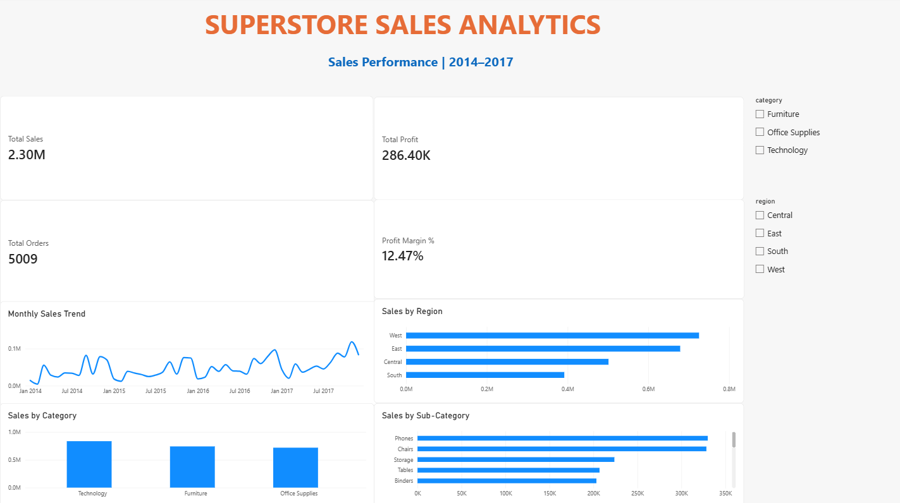

# Superstore-Sales-Analytics

# Superstore Sales Analytics Dashboard

## Project Overview
An interactive sales analytics dashboard built using Microsoft Power BI to analyze sales performance, profitability, order volume, and regional trends.

## Tools Used
- Microsoft Power BI
- Power Query
- DAX (Data Analysis Expressions)
- Data Visualization

## Key Performance Indicators (KPIs)
- **Total Sales:** 2.30M
- **Total Profit:** 286.40K
- **Total Orders:** 5,009
- **Profit Margin:** 12.47%

## Dashboard Visualizations
- Monthly Sales Trend
- Sales by Region
- Sales by Category
- Sales by Sub-Category
- Category and Region slicers for interactive filtering

## Key Insights
- Technology, Furniture, and Office Supplies are the three product categories analyzed.
- Regional sales comparisons help identify differences in sales performance.
- Monthly sales trends reveal changes in performance over time.
- Sub-category analysis helps compare sales across individual product groups.

## Files
- `Superstore_Sales_Dashboard.pbix` — Power BI dashboard file
- `superstore_dashboard.png` — Dashboard screenshot

## How to Use
1. Download the `.pbix` file.
2. Open it using Microsoft Power BI Desktop.
3. Interact with the category and region slicers to explore the data.

## Author
Aspiring Data Analyst | Computer Science (AI & ML)

## Power BI Dashboard

